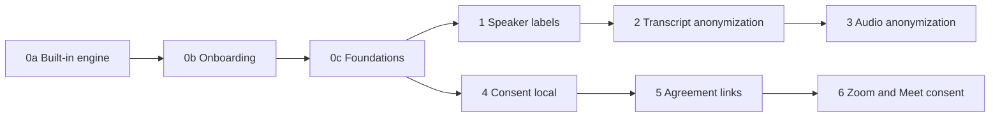

# Roadmap: engine, onboarding, speakers, anonymization, consent

Click a box to open its workflow. Arrows are dependencies.

| # | Phase | Size |
|---|---|---|
| 0a | [[0a Built-in engine]] | 2–3 d |
| 0b | [[0b Onboarding]] | 3–4 d |
| 0c | [[0c Foundations]] | 2 d |
| 1 | [[1 Speaker labels]] | 1–1.5 wk |
| 2 | [[2 Transcript anonymization]] | 1 wk |
| 3 | [[3 Audio anonymization]] | 1 wk |
| 4 | [[4 Consent local]] | 1 wk |
| 5 | [[5 Agreement links]] | 1–2 wk |
| 6 | [[6 Zoom and Meet consent]] | later |

Every phase passes tsc, vitest, cargo test, Playwright and `bench:native` before it is pushed.

## Open decisions
1. Which OS and installer still needs a self-installed whisper-cli (start of 0a)?
2. NER model: GLiNER-small (multilingual, ~150 MB) or a lighter English-only model?
3. May the app add the notice to an existing calendar event, or only draft an email?
4. OK to make the consent Worker the app's first server, kept in this repository?
