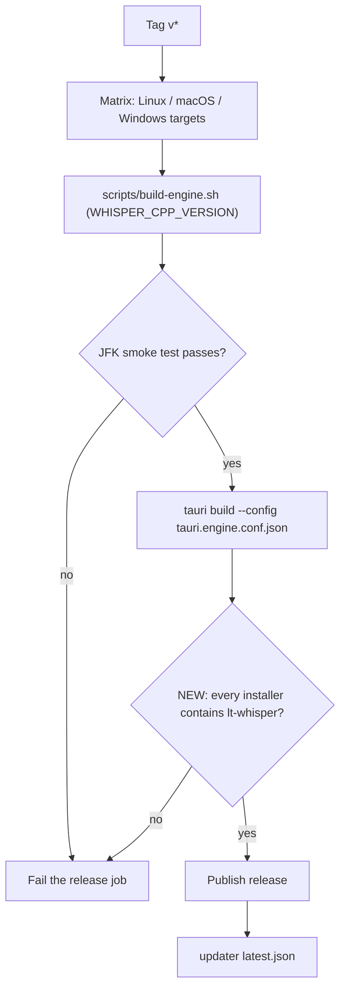
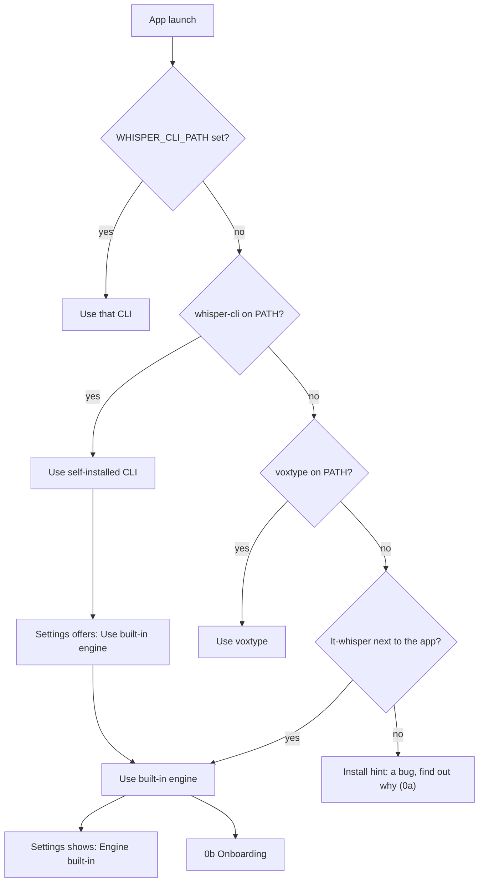

# 0a Built-in engine

Back: [[00 Roadmap]] · Next: [[0b Onboarding]]

Goal: every installer ships whisper-cli (`lt-whisper`); nobody installs it by hand.

## Release build

## Engine lookup at launch

## Tasks
- Find which installer lacks `lt-whisper` or where lookup misses it (`src-tauri/src/models.rs`).
- CI check: unpack each installer and run `lt-whisper --help`.
- Settings: "Engine: built-in" + **Use built-in engine** when a self-installed CLI wins.
- Remove "install whisper-cli" text from the default path.
