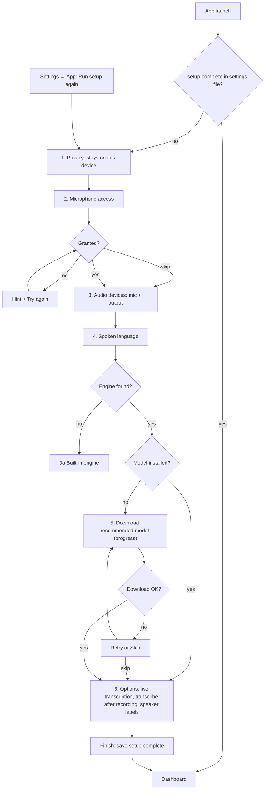

# 0b Onboarding

Back: [[00 Roadmap]] · Prev: [[0a Built-in engine]] · Next: [[0c Foundations]]

Goal: one setup screen (`#/welcome`) on first launch, re-runnable any time from Settings → App **Run setup again**.

## Rules
- Re-run shows current values; finishing changes only what the user changed. Nothing is deleted.
- Every step can be skipped; recording works with no model.
- Disabled while recording or transcribing.
- e2e: `onboarding.spec.ts` (first run, skip, re-run from Settings keeps values).
- Update `docs/REDESIGN.md` with the new screen.
