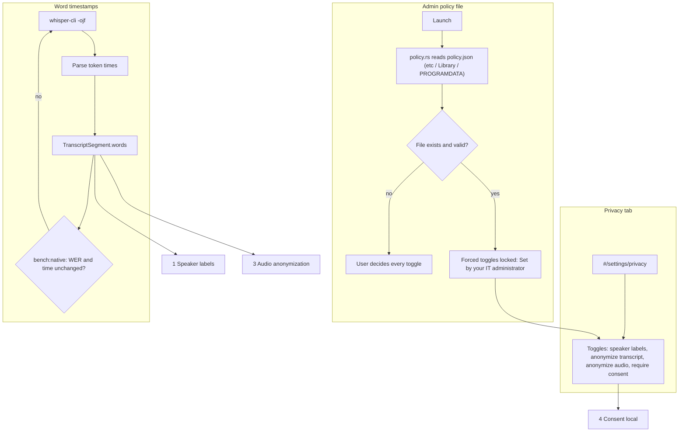

# 0c Foundations

Back: [[00 Roadmap]] · Prev: [[0b Onboarding]] · Next: [[1 Speaker labels]], [[4 Consent local]]

## Tasks
- AGENTS.md exceptions: diarization (MVP §5) and the consent server (no-backend rule).
- voxtype has no timestamps: features needing them show a reason instead.
