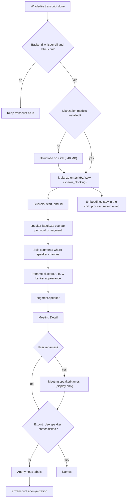

# 1 Speaker labels

Back: [[00 Roadmap]] · Prev: [[0c Foundations]] · Next: [[2 Transcript anonymization]]

Anonymous Speaker A, B, C. No voiceprints kept.

## Tests
- `speaker-labels.test.ts`: overlap, splits, ordering, short blips ignored.
- `cargo test diarize`; e2e with mocked `native_diarize`.
- `src/privacy.test.ts`: models download only on a click.
