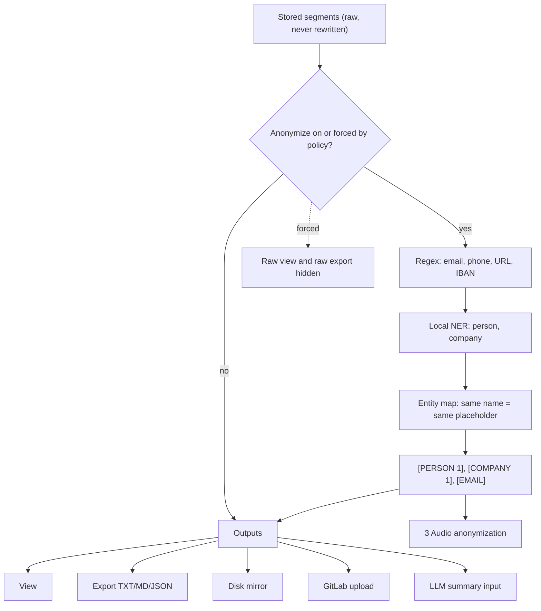

# 2 Transcript anonymization

Back: [[00 Roadmap]] · Prev: [[1 Speaker labels]] · Next: [[3 Audio anonymization]]

## Tests
- `redact.test.ts`: each pattern, stable numbering, no partial-word matches.
- e2e: export and GitLab body contain only placeholders.
