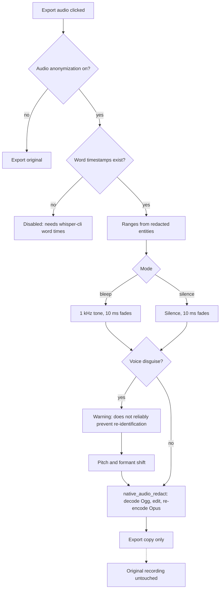

# 3 Audio anonymization

Back: [[00 Roadmap]] · Prev: [[2 Transcript anonymization]]

## Tests
- Rust: ranges land on the right samples; output decodes with ffmpeg.
- e2e: option disabled with reason on voxtype.
