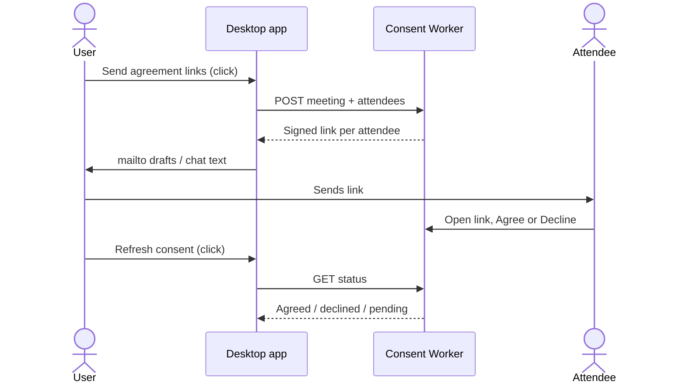
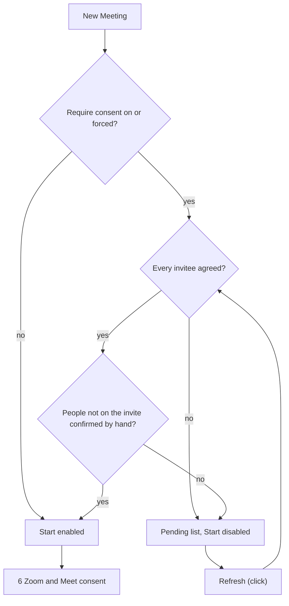

# 5 Agreement links

Back: [[00 Roadmap]] · Prev: [[4 Consent local]] · Next: [[6 Zoom and Meet consent]]

Cloudflare Worker + KV. Stores names, emails and answers only — never audio. The app contacts it only on a click.

## Sending and answering

## Start gate

## Tasks
- `src/privacy.test.ts` + README "Privacy: what goes online": Worker host, click-only.
- KV entries expire (TTL).
