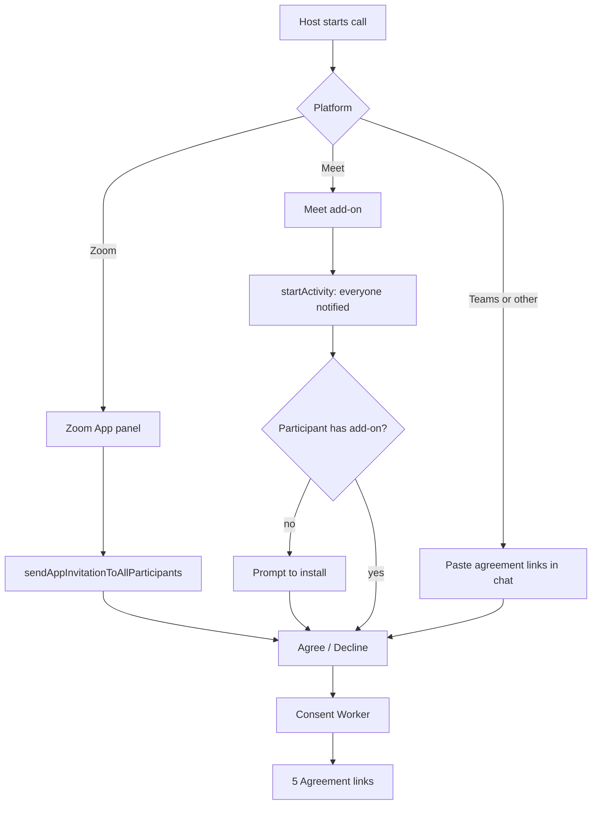

# 6 Zoom and Meet consent

Back: [[00 Roadmap]] · Prev: [[5 Agreement links]]

In-client Agree/Decline panels. They never read meeting audio. Answers go to the Phase 5 Worker.

## Notes
- Zoom: Marketplace review takes weeks.
- Meet: answers via Co-Doing API or the Worker.
